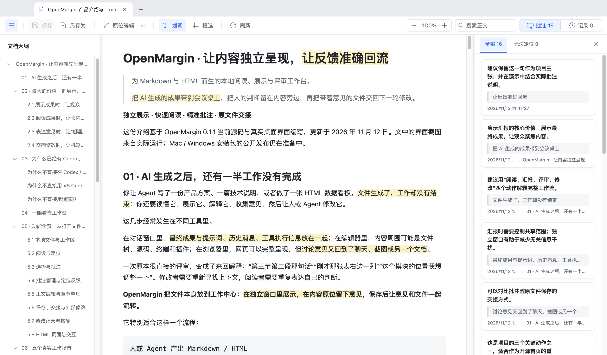
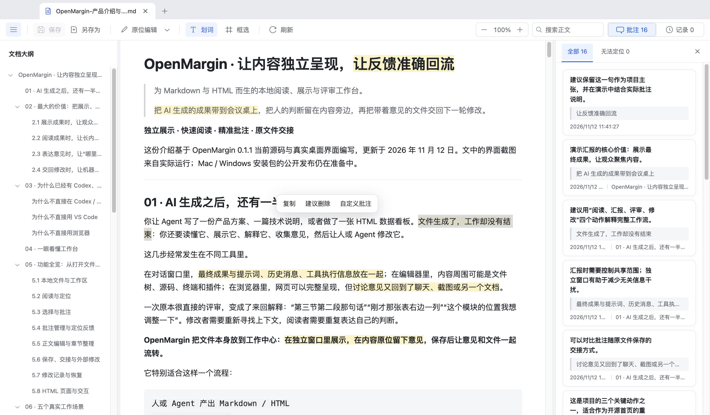
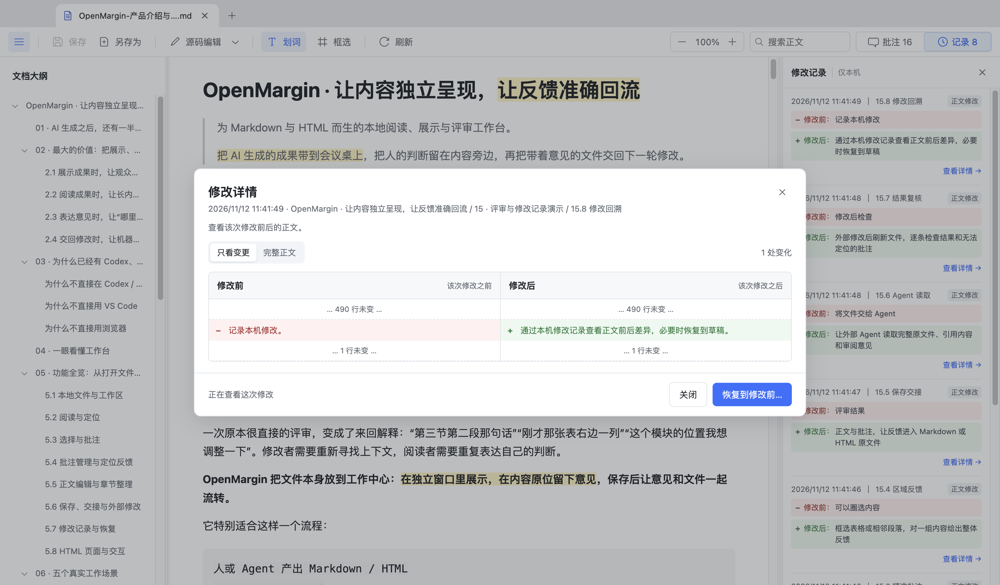

# OpenMargin

**让内容独立呈现，让反馈准确回流。**

OpenMargin 是一个面向本地 Markdown 与 HTML 的阅读、展示和评审工作台。打开人或 AI 已经产出的文件，通过大纲快速理解结构，在文字或区域上留下意见，再把带着批注的原文件交给协作者或外部 Agent 继续修改。



## 为什么需要 OpenMargin

AI 能帮助我们生成方案、报告和网页，但成果生成后仍需要独立展示、仔细阅读、提出意见和反复修改。评审意见如果散落在聊天、截图和另一份记录中，修改者往往还要重新寻找上下文。

OpenMargin 围绕文件组织这段工作：**独立展示 → 快速阅读 → 原位反馈 → 保存交接 → 修改复核**。汇报时可以展示文件而不必同时展示生成过程；评审时可以对具体内容批注；保存后，意见随原文件交接。

Codex、Claude 等 Agent 擅长对话和内容生成，VS Code 擅长工程开发与源码编辑，浏览器擅长展示和运行网页。它们也有各自的预览或扩展能力。OpenMargin 面向的是最终文件的阅读与评审环节，可以与这些工具一起使用。

## 功能

- **独立阅读与展示**：打开 `.md`、`.markdown`、`.html` 和 `.htm`，多标签切换、拖动标签组织窗口，调整大纲、正文和侧栏宽度。
- **快速定位**：标题大纲、章节跳转、正文搜索和页面缩放；可在 Markdown 大纲中复制或删除章节。
- **定位批注**：划选文字或框选区域，添加意见、复制选区文字或快速标记“建议删除”；正文与侧栏之间可以相互定位。
- **批注随文件保存**：Markdown 末尾保存可读审阅区和结构化数据；HTML 在文件末尾以注释保存批注。无法可靠定位的批注会保留并提示。
- **修改和复核**：支持可准确映射文字的原位编辑、源码编辑、撤销和重做；正文修改保存在本机历史中，支持前后对比和恢复到草稿。
- **HTML 预览**：保留页面自身的样式和适用的交互，支持文档目录内受支持的相对资源；复杂网页运行方式可能需要适配。
- **外部修改处理**：检测已打开文件的外部变化，支持刷新与保存冲突检查。HTML 刷新会重置页面的临时交互状态。





更多功能、操作方式、适用场景及工具对比，见 [产品介绍与功能指南](docs/产品介绍与功能指南.md)。可用 [Markdown 演示文件](examples/阅读评审示例.md)、[HTML 演示文件](examples/页面评审示例.html) 和 [HTML 产品展示页](examples/OpenMargin产品展示.html) 试用。

## 快速使用

1. 在 OpenMargin 中打开或拖入 Markdown / HTML 文件。建议先复制重要文件进行体验。
2. 通过大纲或搜索找到要讨论的内容；选中文字或框选区域，添加意见。
3. 点击顶部 **保存**，才会把暂存的批注写入文件。“建议删除”只添加意见，不直接删除正文。
4. 需要调整文字时使用原位编辑或源码编辑；保存后可通过 **记录** 查看本机正文修改历史。
5. 将保存后的文件交给协作者或外部 Agent；修改后刷新并复核意见与正文的对应关系。

应用不内置模型，也不会自动把文件发给 Agent。请在你使用的 Agent 工具中明确要求其读取完整原文件和批注。对于 HTML，仅读取可见页面文字可能遗漏文件末尾的批注注释。

## 安装与平台状态

安装包通过仓库 [Releases](https://github.com/starkfang/OpenMargin/releases) 提供，具体可用版本和签名状态以发布说明为准。项目配置支持构建 Apple Silicon macOS DMG 和 Windows x64 NSIS 安装器；Windows 版本需经过实际安装、文件关联和功能验收后才应作为正式版本发布。

未签名或未公证的测试包可能触发系统提示。请核对发布来源和校验值。当前没有配置自动更新。

## 从源码运行

需要 Node.js 22、npm 和支持图形界面的桌面系统。首次安装依赖需要网络连接。

```bash
npm ci
npm run dev
```

构建与验证：

```bash
npm test                 # Node 与浏览器环境测试
npm run test:e2e         # Electron 桌面端回归测试
npm run dist:mac         # macOS Apple Silicon DMG，在 macOS 上执行
npm run dist:win         # Windows x64 NSIS 安装器，建议在 Windows 上执行
```

安装包输出到 `release/`。签名与公证需要另行配置证书及构建环境；默认 CI 产物为未签名测试包。GitHub Actions 分别在 macOS 和 Windows 构建，并上传短期保存的测试产物。

## 文件与数据

- **正文与批注**保存在原 Markdown / HTML 文件中；保存会更新原文件。
- **正文修改记录**和部分阅读偏好保存在本机应用数据中，不会随文件移动，也不替代版本控制或备份。
- **未保存的草稿**不在原文件中。关闭或刷新前请按提示处理。
- 基本文件操作不要求账号。HTML 文件自身的网络资源和脚本仍可能联网，应只打开可信来源的文件。
- 本工具不提供实时多人协作、云同步、内置模型或 PDF / Word 原生编辑。

## 参与贡献

欢迎通过 issue 反馈问题和提出建议，也欢迎提交改进。请阅读 [贡献指南](CONTRIBUTING.md)。报告问题时请移除文件路径、个人信息和敏感内容，尽量使用可公开的最小示例。

## 许可证

本项目采用 [MIT License](LICENSE)。第三方组件相关声明见 [THIRD_PARTY_NOTICES.txt](THIRD_PARTY_NOTICES.txt)。
