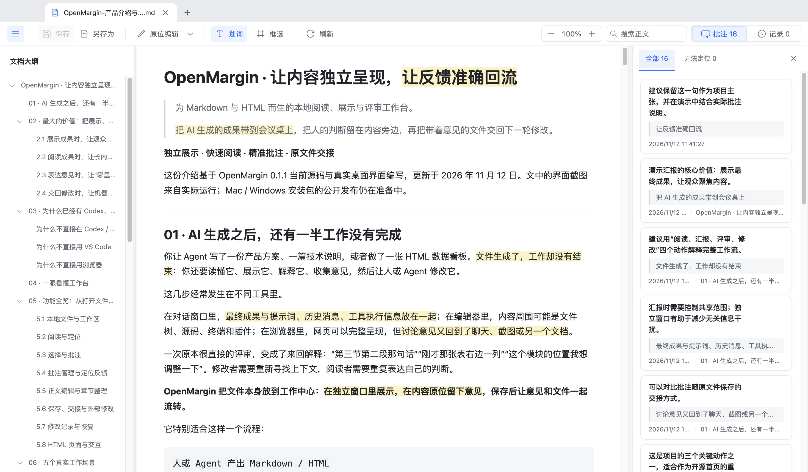
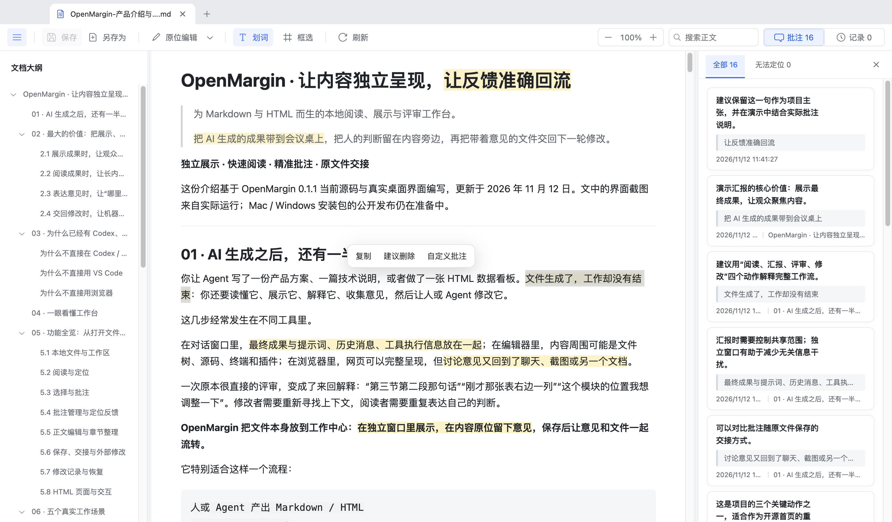
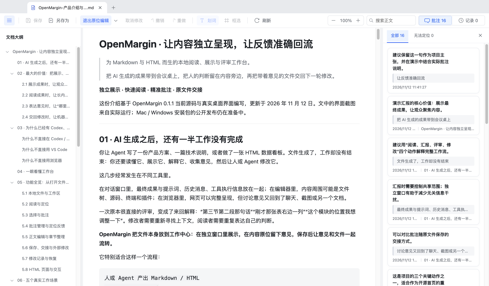
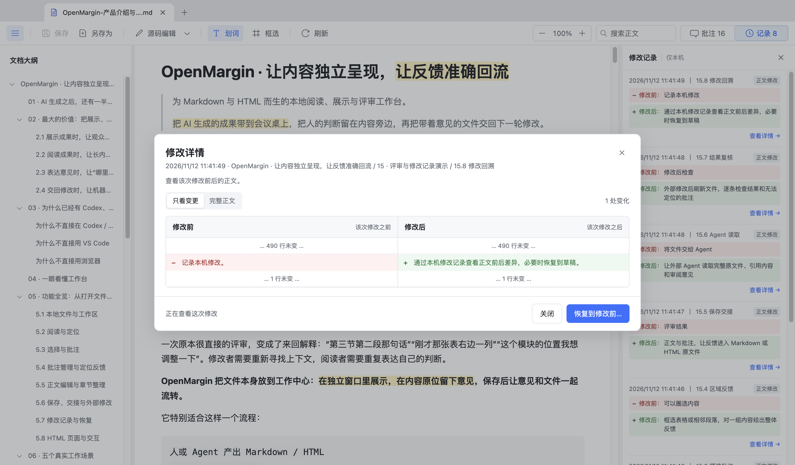
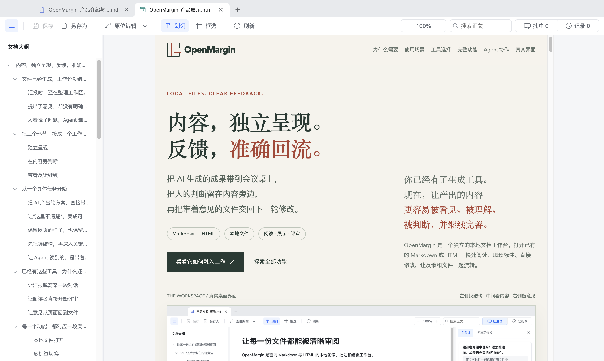

# OpenMargin · 让内容独立呈现，让反馈准确回流

> 为 Markdown 与 HTML 而生的本地阅读、展示与评审工作台。
>
> 把 AI 生成的成果带到会议桌上，把人的判断留在内容旁边，再把带着意见的文件交回下一轮修改。

**独立展示 · 快速阅读 · 精准批注 · 原文件交接**

这份介绍基于 OpenMargin 0.2.0 当前源码与真实桌面界面编写，更新于 2026 年 11 月 12 日。文中的界面截图来自实际运行；具体支持的平台和安装包以仓库发布说明为准。

> 为便于体验，本文附带 16 条演示批注；修改记录保存在生成它们的本机，不随文件分发。

---

## 01 · AI 生成之后，还有一半工作没有完成

你让 Agent 写了一份产品方案、一篇技术说明，或者做了一张 HTML 数据看板。文件生成了，工作却没有结束：你还要读懂它、展示它、解释它、收集意见，然后让人或 Agent 修改它。

这几步经常发生在不同工具里。

在对话窗口里，最终成果与提示词、历史消息、工具执行信息放在一起；在编辑器里，内容周围可能是文件树、源码、终端和插件；在浏览器里，网页可以完整呈现，但讨论意见又回到了聊天、截图或另一个文档。

一次原本很直接的评审，变成了来回解释：“第三节第二段那句话”“刚才那张表右边一列”“这个模块的位置我想调整一下”。修改者需要重新寻找上下文，阅读者需要重复表达自己的判断。

**OpenMargin 把文件本身放到工作中心：在独立窗口里展示，在内容原位留下意见，保存后让意见和文件一起流转。**

它特别适合这样一个流程：

```text
人或 Agent 产出 Markdown / HTML
                ↓
OpenMargin 独立打开、阅读与演示
                ↓
人在具体文字或区域上给出反馈
                ↓
保存：正文与批注保留在同一个文件
                ↓
协作者 / 外部 Agent 读取原文件并修改
                ↓
重新加载，复核修改结果
```

OpenMargin 当前提供文件阅读、评审和编辑能力。上图中的 Agent 是你另行使用、并有权读取该文件的外部工具；应用本身不会自动调用模型或自动发送文件。

## 02 · 最大的价值：把展示、判断与修改接起来

### 2.1 展示成果时，让观众只需要理解成果

面对同事、客户或团队，你真正希望展示的是方案、文档和页面。独立的文档窗口让你可以直接共享成果，把生成过程、历史对话和其他任务留在自己的工作区。

OpenMargin 不要求观众理解某个 AI 产品的操作方式，也不要求你为了汇报重新制作一份材料。已有的 Markdown 或 HTML，就是可以展示、阅读和讨论的成果。

你可以隐藏大纲或批注侧栏，调整阅读宽度和缩放；讨论进入细节时，再打开侧栏，把意见落到对应内容上。这里说的“展示”是文档与网页的独立呈现，当前没有专门的幻灯片演讲模式或演讲者备注。

### 2.2 阅读成果时，让长内容更容易被掌握

一份长方案的价值，不在于打开后能从头滚到尾，而在于能迅速找到问题所在。标题大纲提供结构，正文搜索提供线索，页面缩放和可调布局提供舒适的阅读空间。

你可以先看结构，再检查关键段落；先定位某个术语，再核对它在不同章节中的表述。Markdown 和 HTML 都可以在同一套工作方式下阅读。

### 2.3 表达意见时，让“哪里需要改”变得明确

选中一句话，留下修改建议；框选一组内容，讨论整体安排；点击“建议删除”，快速表达删减意见。批注保留引用、位置线索、章节和时间，方便下一位阅读者理解你当时针对的是什么。

你不用把正文反复复制进聊天，也不用只靠截图上一个难以描述的红框解释问题。批注就在内容旁边，正文和意见可以相互定位。

### 2.4 交回修改时，让机器也能读到人的判断

保存后的批注进入原文件。Markdown 包含可读的审阅区和结构化数据；HTML 把批注数据保存在文件末尾的注释里。

这为人工反馈进入 Agent 工作流提供了明确入口：**让 Agent 读取带批注的原始文件，再依据引用内容与意见修改正文。**

这不是一个“AI 会自动理解一切”的承诺。HTML 批注需要读取原始源码；只提取浏览器可见文字的工具可能读不到注释。结构化信息能够帮助定位，最终修改仍需要人复核。

## 03 · 为什么已经有 Codex、Claude、VS Code 和浏览器，还需要它

这些工具各自解决不同阶段的问题。选择 OpenMargin 的理由，是你此刻需要一个围绕最终文件展开的阅读与评审空间。

| 工具或工作方式 | 最擅长的工作 | 在独立演示与文件评审中的取舍 | OpenMargin 的位置 |
| --- | --- | --- | --- |
| Codex、Claude 等 Agent / 对话工作区 | 讨论需求、生成内容、运行工具、继续修改 | 当文件与对话处于同一工作区时，需要管理展示范围，避免让无关历史和工作信息进入汇报；不同产品也可能提供独立预览或分享能力 | 接住已经生成的本地文件，把成果呈现和人工评审放进独立窗口 |
| VS Code | 源码编辑、项目导航、版本控制、开发扩展 | 已有 Markdown 预览，也能通过配置和扩展组织其他能力；要形成统一的文件批注交接流程，仍需选定工作方式 | 把大纲、选择、批注、回写文件组织为面向阅读者的直接操作 |
| 普通浏览器 | 展示 HTML、执行网页交互、检查页面效果 | 展示单个 HTML 已经非常合适；跨 Markdown / HTML 的一致评审，以及把定位意见写回原文件，需要额外工具或扩展 | 在网页呈现之外，增加文件级阅读、批注、保存和复核流程 |
| 聊天消息 + 截图 | 快速沟通、即时讨论、远程交流 | 反馈常与原始内容分离；修改者需要把截图、描述和正文重新对应起来 | 让意见保留引用与定位线索，随原文件交回修改 |

### 为什么不直接在 Codex / Claude 里汇报

如果只是向自己展示生成结果，继续留在原来的工作区很方便；如果需要跟客户开会、向团队汇报，或者把窗口交给另一位同事阅读，独立呈现就有价值。

对话工作区保留了“如何产生成果”的上下文，而汇报通常需要聚焦“成果是什么、哪里需要讨论”。OpenMargin 让你以文件为边界组织展示，无需把一次生成任务的对话过程也带入会议。

这不意味着这些产品不能独立展示。它们的预览、分享和成品能力会持续变化；OpenMargin 选择的是不依附某个会话、可由多个来源产出文件的本地工作方式。有关产品定位，可参考 [Codex 官方介绍](https://openai.com/index/introducing-the-codex-app/) 与 [Claude 官方 Artifact 分享说明](https://support.claude.com/en/articles/9547008-share-artifacts)。

### 为什么不直接用 VS Code

需要修改工程代码、调试脚本或管理项目时，VS Code 很合适。它本来就有 Markdown 预览，不应该把“能预览 Markdown”当作 OpenMargin 独有的能力。[VS Code 官方 Markdown 文档](https://code.visualstudio.com/docs/languages/markdown)

OpenMargin 的重点是另一类使用者和任务：阅读者打开文件就能看结构、选内容、写意见，再把意见存回文件。对于主要承担评审、汇报和确认工作的同事，这套流程更贴近他们正在做的事。

如果你已经有成熟的 VS Code 扩展工作流，继续使用完全合理。OpenMargin 提供一个可以单独交给阅读者的工作台。

### 为什么不直接用浏览器

只需要展示一个 HTML 页面时，浏览器往往已经足够。OpenMargin 的增量价值出现在下一步：会议中有人提出意见，阅读者需要标注一个区域，或者希望将意见交回文件，让下一位修改者继续处理。

当工作需要同时覆盖 Markdown 与 HTML，并反复经历“阅读 → 标注 → 保存 → 修改 → 复核”，统一的评审入口能够减少来回切换。

## 04 · 一眼看懂工作台



图中是实际运行的 OpenMargin：正文中的高亮与右侧意见对应；大纲提供章节入口，顶部提供编辑、批注、刷新、缩放与搜索。

| 区域 | 提供什么 | 在什么场景下使用 |
| --- | --- | --- |
| 文件标签 | 切换、关闭多个已打开文件；拖动标签组织窗口 | 同时核对一份方案和对应的 HTML 页面 |
| 文档大纲 | 标题层级、章节定位、展开与收起 | 汇报时直接跳到“实施方案”，评审时快速检查文档结构 |
| 正文画布 | Markdown 渲染或 HTML 自身的排版与交互 | 以成品形态阅读内容、展示页面和理解布局 |
| 顶部工具栏 | 保存、另存为、编辑、选择模式、刷新、缩放、搜索 | 在阅读和修改之间直接切换 |
| 批注侧栏 | 集中阅读意见、查看引用、定位正文、修改或删除批注 | 按条复核反馈，检查还有哪些意见无法对应正文 |
| 修改记录侧栏 | 本机保存的正文改动摘要、前后差异和恢复入口 | 回答“刚才到底改了什么”，或者找回一次修改前的正文 |

## 05 · 功能全览：从打开文件到完成复核

### 5.1 本地文件与工作区

**打开 Markdown 和 HTML。** 支持 `.md`、`.markdown`、`.html`、`.htm`。通过打开文件对话框或拖放文件进入工作区。适用于已有的需求文档、项目说明、AI 生成报告和本地网页方案；不需要先上传到一个新平台。

**多标签切换。** 在同一窗口打开多份文件，通过标签快速切换。适用于一边看需求、一边看方案，或者核对 Markdown 说明与 HTML 演示。当前会话中的草稿和阅读状态会随标签切换保留；这不等于应用退出后自动恢复整套未保存会话。

**标签拖动与多窗口。** 可以拖动标签调整组织方式，把文件拖到独立窗口，或转移到其他窗口。适用于双屏汇报、并排核对文件，以及把一份文件单独拿出来展示。同一文件由一个窗口持有，减少两个窗口同时修改同一份内容造成混淆。

**系统打开文件。** 项目包含文件关联配置和系统文件打开处理逻辑。安装正确配置的发行包后，可以通过系统的“打开方式”等入口交给应用。具体关联行为需要分别在 Mac 与 Windows 安装版中验证，不能用开发版启动成功代替验收。

### 5.2 阅读与定位

**标题大纲。** 从文档标题建立层级导航，点击章节定位正文，展开或收起层级。适用于长文档汇报、分章节评审，以及快速了解一份陌生文件的结构。没有可识别标题的文件会提示缺少大纲，而不会凭空生成目录。

**正文搜索。** 在阅读视图中查找文字，显示匹配数量，向前或向后切换结果。适用于检查术语是否一致、定位某个需求编号、回到刚才讨论的内容。它是当前文件的正文搜索，不是整个文件夹或所有标签的全文检索。

**页面缩放。** 以 10% 为步进在 50%–200% 之间调整，并可点击百分比恢复 100%。适用于投屏、小字表格、不同分辨率屏幕和个人阅读习惯。缩放调整的是文档呈现，不会修改源文件的字号。

**可调阅读布局。** 拖动分隔位置调整大纲、正文阅读区与侧栏宽度；也可以隐藏侧栏，让更多空间留给正文。适用于纯展示时聚焦成果，评审时同时查看正文与意见。布局偏好保存在本机。

**阅读位置与缩放记忆。** 应用保存部分按文件区分的阅读偏好。适用于在长材料之间切换后继续阅读。此类偏好不写进文件，也不会自动同步到另一台电脑。

### 5.3 选择与批注

**划词批注。** 选中正文文字，打开“自定义批注”，输入具体意见。适用于定义不清、数据需要核对、措辞需要调整的段落；引用文字使修改者知道意见针对哪里。

**跨格式内容选择。** 可以围绕包含不同文字格式或跨内容块的选区进行评审，系统保留相应定位线索。适用于一句话横跨加粗、链接或多个文本片段的情况。具体能否准确定位仍取决于文档结构和后续变化。

**区域框选。** 切换“框选区域”，拖动鼠标圈出需要讨论的内容。适用于一组指标、整张表的局部、多个相邻段落或局部布局。区域批注是位置与内容线索，不是截图 OCR，也不代表能理解框内图片的语义。

**选区复制。** 选择后点击“复制”，取出选中文字或框选范围内可识别的文字。适用于会议纪要、引用原文、补充需求说明。纯图片中的文字不会因为框选就自动识别出来。

**建议删除。** 选中内容后点击“建议删除”，快速添加一条内容为“删除”的批注。适用于重复段落、冗余描述和待删信息。它表达审阅意见，不会直接删除正文。

**表格内容批注。** 对表格中的文字划选，或使用适用的单元格右键入口，留下意见。适用于核对时间、口径、范围、验收标准和数据解释；反馈能够针对表内内容，而不必只说“这张表有问题”。



### 5.4 批注管理与定位反馈

**集中查看批注。** 在侧栏查看当前文件的意见、引用、章节和时间。适用于开评审会时逐条讨论，以及修改后按条复核。

**正文与批注联动。** 点击正文标记或批注引用，查看相应意见并定位内容；在适用布局下显示连接提示。适用于回答“这条意见对应哪里”，减少正文与侧栏之间的反复寻找。

**修改与删除批注。** 可以修订意见或删除不再需要的批注；修改后的批注记录更新时间。适用于讨论结论发生变化、反馈文字不够清楚或需要收敛意见的时候。变更仍需要保存到文件。

**无法定位提示。** 正文发生变化后，如果应用无法可靠对应原内容，会保留批注并列入“无法定位”。部分内容仍可定位时，也有相应状态提示。适用于 Agent 已改写大段文字后的复核；比把旧意见强行贴到一个看似相同的位置更容易判断实际状态。

**批注暂存与统一保存。** “添加批注”先进入当前文件工作区；点击顶部“保存”才写入磁盘。适用于先集中形成一组意见，再一次性保存。尚在输入框里的批注草稿，需要先添加或取消，再执行相应文件操作。

### 5.5 正文编辑与章节整理

**原位编辑。** 切换到“原位编辑”，在可准确映射回源文件的普通文字上直接修改。适用于会中修正一个标题、补全一句说明、调整一段短文字，不必为了小修改切走阅读视图。

**连续修改多个位置。** 可以先调整几处正文，再统一保存；取消修改则放弃本轮未保存的原位改动。适用于一次评审中处理若干小问题。动态生成内容、复杂结构或映射不明确的位置，可能拒绝原位写回。

**源码编辑。** 从编辑方式菜单选择“源码编辑”，直接修改 Markdown 或 HTML 原文。适用于结构调整、格式修订、复杂段落，以及原位编辑无法安全处理的内容。

**撤销与重做。** 在编辑过程中回退或恢复未保存的正文修改。适用于试写、误删或反复斟酌措辞。它面向当前编辑过程，与已经保存的正文历史是两个不同机制。

**复制 Markdown 章节。** 在 Markdown 大纲中右键目标章节，选择“复制章节”，取得包含子章节的原始 Markdown 内容。适用于把某个需求模块发给协作者，或者拆出一个局部方案继续讨论。

**删除 Markdown 章节。** 在大纲右键菜单中删除章节及其子章节；操作进入正文草稿，可撤销，保存后才更新原文件。适用于重组方案结构或移除整段不再需要的内容。该入口针对 Markdown；它与“建议删除”批注有不同作用。



### 5.6 保存、交接与外部修改

**保存原文件。** 将正文与已经暂存的批注写回当前文件。适用于完成一轮评审后交回修改者。文件内容会变化；本机历史和阅读布局不会随文件一同交付。

**另存为。** 用新的文件名保留当前正文与批注，原文件继续保留。适用于为一次评审建立副本，或保留修改前的材料。当前要求保持原文件格式，并选择不存在的新目标文件；另存 HTML 不会自动打包其关联资源目录。

**外部变化检测。** 文件被外部编辑器或 Agent 改动后，应用尝试更新预览；存在未保存修改时提示并保留当前工作状态，等待你处理。适用于 Agent 在另一个工作区改文件、你继续查看结果的协作方式。

**手动刷新。** 点击“刷新”重新读取文件与 HTML 关联资源。适用于外部更新样式、图片、脚本，或者需要明确重新载入当前成果。HTML 页面的临时交互状态会重置；未保存内容需要先处理。

**保存冲突检查。** 保存时比对文件内容指纹，并通过临时文件替换减少不完整写入。适用于外部工具也在修改同一份文件的场景。这不是多人协同合并系统，仍应避免多个程序同时写同一文件。

### 5.7 修改记录与恢复

**正文修改记录。** 应用保存正文改动时，在本机记录修改前后的内容，并提供时间、章节和摘要。适用于追溯一次措辞调整、了解最近一轮修改涉及哪里。仅修改批注不会变成一条正文改动记录，外部文件修改也不等同于应用内的每次保存历史。

**前后差异对比。** 在记录中选择“查看详情”，对照修改前后；可以聚焦变更，也可以查看完整正文。适用于会议现场解释调整点，或自己检查是否误改了其他内容。

**恢复到草稿。** 从某次记录进入恢复预览，将整份正文恢复到该次修改之前的状态，先放入草稿，确认后再保存。适用于回退一次不合适的修改。恢复面向整份正文，当前批注保留；需要复核它们是否仍能准确定位。



### 5.8 HTML 页面与交互

**保留页面原有呈现。** HTML 使用自身的样式与内容结构展示。适用于已有的落地页、可视化报告、产品方案页和 AI 生成的演示页面。

**运行适用的页面交互。** 预览支持页面脚本、按钮切换等交互。适用于在汇报时操作示例，边演示边讨论；内容运行在隔离的预览环境里，不直接获得桌面应用的文件接口。

**读取支持的相对资源。** 支持将文档目录范围内可处理的 CSS、图片、脚本等资源用于预览。适用于一个 HTML 文件搭配资源文件夹的成果。复杂模块导入、运行时读取本地文件、严格 CSP 等机制可能需要额外适配；它并非任意网站的完整运行环境。

**评审动态内容。** 页面交互后的文字可以在支持范围内参与阅读、搜索与批注。适用于交互报告和动态显示区域。但运行时生成的文字未必对应一段可写回的源码，原位编辑会受到限制。



## 06 · 五个真实工作场景

### 场景一：把 Agent 产出的方案带去汇报

**原来的摩擦：** 方案在 AI 工作区里，汇报者一边解释内容，一边管理聊天历史、其他任务和窗口布局。

**使用方式：** 让 Agent 输出 Markdown 或自包含 HTML；用 OpenMargin 打开，关闭无关侧栏，调整缩放；用大纲按章节讲解。进入讨论时，选中相关段落并留下意见。

**得到什么：** 同一份文件既是展示材料，也是评审对象；会后的意见可以随文件保存下来。

### 场景二：产品经理评审一份需求说明

**原来的摩擦：** “这段需求不清楚”被写进聊天，开发还要反复确认到底指哪句话、哪个条件。

**使用方式：** 用大纲逐节检查目标、流程和验收标准；搜索关键术语；对定义模糊的句子、表格中的边界条件分别批注。

**得到什么：** 反馈包含引用与上下文，更适合交给同事或 Agent 按条处理。

### 场景三：设计与业务一起讨论 HTML 原型

**原来的摩擦：** 浏览器能展示页面，但每条意见都依赖口头描述、截图或另一份记录。

**使用方式：** 打开 HTML，保留原有排版和可用交互；对文案划词，对局部布局框选；在侧栏集中查看意见。

**得到什么：** 讨论围绕页面本身展开；保存后的原 HTML 还携带批注数据，便于后续读取和修改。

### 场景四：技术负责人快速检查一份长文档

**原来的摩擦：** 需要浏览大量内容，反复寻找前文定义、接口约束和不一致的表述。

**使用方式：** 大纲定位模块，正文搜索术语，复制相关章节；直接修正小处文字，对需要进一步论证的位置留下批注。

**得到什么：** 快速阅读、局部修改和深入评审可以连续完成。

### 场景五：把人工审阅变成下一轮 Agent 的输入

**原来的摩擦：** 人在某处形成了判断，Agent 收到的却是几句没有原文对应关系的聊天要求。

**使用方式：** 在 OpenMargin 中逐处批注并保存；让外部 Agent 读取原文件中的正文与批注区；修改结束后回到应用刷新并复核。

**得到什么：** 人的判断通过文件被保留下来，生成工具可以变化，评审对象和反馈入口保持一致。

## 07 · 批注为什么能交给 Agent

### 7.1 文件是双方共享的上下文

人看到的是排版后的文档，Agent 读取的是原始文件。OpenMargin 将二者连接起来：引用文字帮助理解内容，章节和锚点帮助定位，意见正文表达修改意图，时间说明反馈何时形成。

| 文件格式 | 保存后的内容 | 适合如何交给 Agent |
| --- | --- | --- |
| Markdown | 原正文 + 可读的“审阅批注”区 + 结构化批注数据 | 读取完整 Markdown，结合引用和意见理解修改任务 |
| HTML | 原始 HTML + 文件末尾注释中的结构化批注数据 | 读取原始源码与末尾注释，而非仅抓取页面可见文本 |

文件可以通过已有的版本管理、共享文件夹或交付流程流转。项目当前没有云端账号、实时协作或自动同步功能。

### 7.2 一条更容易执行的反馈

不够具体的反馈：

> 这一部分再完善一下。

更容易交接的反馈：

> 引用：“系统应在短时间内返回结果。”
>
> 意见：“请补充明确的响应时间指标，并区分正常负载与峰值负载；如暂时没有数据，请标为待验证，不要自行编造。”

OpenMargin 负责把引用和意见保留下来；反馈的准确性，仍来自评审者的判断。

### 7.3 可复制的 Agent 交接指令

```text
请读取这份文档的完整原始内容，包括 OpenMargin 保存的审阅批注。
如果是 HTML，请同时读取文件末尾的批注注释，不要只提取可见正文。

先按条列出：引用内容、意见、拟采取的修改。
仅处理能够明确对应到正文的意见；遇到歧义或无法定位的内容先列出说明。
保持文件现有格式、与本轮意见无关的内容及批注数据。
完成后给出逐条修改说明，供我回到 OpenMargin 复核。
```

当前应用没有“发送给 Agent”按钮、自动提示词执行或批注完成状态流转。上面的交接由你在所使用的 Agent 工具中完成。

## 08 · 十分钟体验一次完整评审

1. **准备副本。** 复制一份 Markdown 或 HTML，或使用随附的演示文件。
2. **快速读结构。** 打开文件，查看大纲，搜索一个出现多次的关键词，调整缩放。
3. **留下第一条意见。** 选中一句话，点击“自定义批注”，写出可以执行的建议，再添加到工作区。
4. **给一组内容提意见。** 切换“框选区域”，对表格或相邻段落添加第二条批注。
5. **保存。** 点击顶部“保存”；用文本编辑器查看原文件，确认批注已经进入文件。
6. **修正一句话。** 使用原位编辑修改普通文本；需要改结构时切换源码编辑。
7. **查看差异。** 保存后打开“记录”，查看这次修改前后的内容。
8. **交接与复核。** 让协作者或外部 Agent 阅读已保存的文件；外部修改后重新加载，检查正文与批注的位置。

本说明本身也可以作为试用文档：标题可测试大纲，表格可测试选择与批注，下面的案例可用于原位编辑与评审。

## 09 · 一份可以直接标注的微型方案

### 演示案例：文档评审流程优化

团队希望让需求评审过程更加清晰，减少因为定位不准造成的重复沟通。

**目标表述：评审效率应该得到明显提升。**

请尝试选中这句话，留下具体意见，例如：“请定义效率的测量方式、对比基线与观察周期，不要只使用‘明显提升’。”

| 待评审事项 | 当前说明 | 适合提出的反馈 |
| --- | --- | --- |
| 展示内容 | 使用已有 Markdown 和 HTML 文件进行汇报 | 哪些文件需要提前准备为自包含版本？ |
| 意见记录 | 对关键段落和表格留下批注 | 反馈中是否包含原文引用和明确修改要求？ |
| 修改交接 | 将带批注的文件交给外部 Agent | Agent 是否读取完整文件及 HTML 末尾注释？ |
| 结果复核 | 修改后刷新并逐条检查 | 无法定位的意见由谁复核？ |

### 可直接编辑的句子

这份方案将持续完善，下一步需要补充验收标准。

你可以把“补充验收标准”改为更具体的目标，再保存并查看修改记录。要保留此介绍的原稿，请先另存为副本。

## 10 · 文件、草稿与历史分别在哪里

| 内容 | 保存位置 | 随原文件交接吗 | 需要注意什么 |
| --- | --- | --- | --- |
| 正文与已保存批注 | 当前 Markdown / HTML 文件 | 是 | 文件会被更新；可用版本控制或副本管理版本 |
| 已添加但未保存的批注 | 当前应用工作区 | 否 | 点击顶部“保存”后才进入文件 |
| 尚未添加的批注输入 | 当前批注草稿 | 否 | 先添加或取消，再处理切换等操作 |
| 未保存的正文修改 | 当前编辑状态 | 否 | 关闭前需要保存或明确放弃 |
| 正文修改记录 | 本机应用数据目录 | 否 | 不等同于跨设备备份，也不替代 Git |
| 布局、缩放等阅读偏好 | 本机应用存储 | 否 | 不作为文档正文的一部分交付 |
| HTML 外部资源 | 原资源路径或网络地址 | 不一定 | 交付关联目录；网络资源可能仍需联网 |

基本阅读和编辑不要求登录云账号；自包含文档可以本地使用。HTML 本身若引用网络资源或运行联网脚本，仍可能发起网络请求，不能把“本地文件”理解为“所有内容绝不联网”。

## 11 · 哪些任务适合，哪些任务应交给其他工具

OpenMargin 尤其适合本地文档阅读、独立展示、具体位置批注、局部正文编辑，以及人与 Agent 之间基于文件的反馈交接。

对于以下任务，可以继续使用擅长它们的工具：

- 代码调试、复杂工程开发、依赖管理：使用开发环境。
- 任意网站的完整兼容性测试、复杂网络应用调试：使用浏览器和对应运行环境。
- 实时多人协作、评论分配、权限管理、在线审批：使用协作平台。
- PDF、Word、Excel 或演示文稿原生编辑：使用对应格式的工具；当前支持范围是 Markdown 与 HTML。
- 自动调用模型、自动执行批注、自动生成内容：使用你已有的 Agent 工具，并在修改后回到文件中复核。

这样的分工让每个工具承担它更适合的那一段工作。

## 12 · 安装与开源发布准备

### 当前核实到的事实

项目使用 Electron 桌面架构，界面基于 React 与 Vite，已有 macOS 应用构建配置，本地存在 Apple Silicon 的应用和 DMG 产物。项目提供单元测试与端到端测试，具体发布版本以构建和平台验收结果为准。

这些结果证明本机的基础构建和相应功能路径可运行，不代表 Windows 版已经通过测试，也不代表现存 DMG 一定对应当前提交。

### 推荐的分发形式

| 目标 | 建议交付物 | 当前状态 |
| --- | --- | --- |
| Apple Silicon Mac | `.dmg`，可另附 `.zip` | 已有本地构建基础；正式版本仍需统一构建、安装验证和签名状态说明 |
| Windows 11 x64 | NSIS `.exe` 安装器 | 技术路线可行；需要补齐配置、兼容修复与安装验收 |
| Windows 11 ARM64 | 独立 ARM64 安装器 | 适合 ARM 设备；可利用当前 ARM 虚拟机验证 |
| Intel Mac | x64 `.dmg` 或后续通用版本 | 作为扩展目标，需单独构建与验证 |

建议 Windows 使用 GitHub Actions 的明确 x64 runner 构建，再结合本地 Windows 11 ARM 虚拟机验证安装与运行；ARM 环境中的 x64 运行属于模拟执行，不能替代原生 x64 测试。[GitHub runner 官方说明](https://docs.github.com/en/actions/reference/runners/github-hosted-runners) · [微软 Windows on Arm 说明](https://learn.microsoft.com/en-us/windows/arm/apps-on-arm-x86-emulation)

### 正式发布前需要完成

- 修正 Windows 路径兼容：当前 Markdown 资源基址拼接依赖 `/`，反斜杠路径会产生错误基址。
- 补齐 Windows 图标、安装器配置、快捷键提示、文件关联、安装与卸载测试。
- 项目采用 MIT 许可证，持续维护依赖声明、README、贡献说明与已知限制；第三方声明不等于项目许可证。
- 确定受支持的 Electron 版本并回归测试。发布前应依据官方支持周期复核运行时版本和升级后的回归结果。[Electron 官方支持策略](https://www.electronjs.org/docs/latest/tutorial/electron-timelines)
- 用同一份确定的源码构建发布物，记录版本与提交，生成校验值，公开说明签名及公证状态。
- 在独立安装环境测试首次启动、中文路径、相对资源、保存、文件关联和卸载；Windows 中还需覆盖文件占用与不同显示缩放。

安装包的目标是让使用者下载后就能体验；源码、介绍、截图、示例文件和安装包共同构成完整的开源交付。代码签名会影响安装信任体验，具体行为应以发行包实际验证为准，不能保证“签名后一定没有系统提示”。[微软代码签名说明](https://learn.microsoft.com/en-us/windows/apps/package-and-deploy/code-signing-options)

## 13 · 适合放进 GitHub 的展示素材

`images` 文件夹中保存了实际桌面截图，`examples` 文件夹中提供可操作的示例文件。Markdown 中的图片使用相对路径；把本说明和 images 文件夹一起放入仓库即可保留图片关系。

| 截图文件 | 想传达的价值 | 建议放在介绍的什么位置 |
| --- | --- | --- |
| `12-md-review-overview.png` | 大纲、正文、批注集中在同一工作台 | 项目定位之后，作为主界面展示 |
| `13-md-selection.png` | 针对具体文字直接表达意见 | “精准批注”功能说明 |
| `14-md-inline-edit.png` | 小修改可以在阅读现场完成 | “原位编辑”功能说明 |
| `15-md-history-compare.png` | 修改有前后对照，方便复核 | “改动可追溯”说明 |
| `11-html-product-intro.png` | 保留网页风格与场景交互 | “支持 HTML”及网页场景说明 |

配套 HTML 采用产品展示页的叙事方式，适合直接打开演示或分章节截图；本 Markdown 更适合仓库长介绍、详细阅读和实际功能试用。

## 14 · 常见问题

**这是一个新的 AI 聊天软件吗？**

当前不是。它接收已有的 Markdown / HTML 文件，为它们提供独立的阅读、展示、评审和编辑空间。

**是不是需要把文档上传到服务器？**

基本文件操作在本机完成，不要求上传或登录。文档自身的网络资源和脚本行为需要单独理解。

**批注只有 OpenMargin 才能读到吗？**

保存后，批注进入原文件。Markdown 中有可读审阅区，HTML 中有源码注释数据；外部工具是否读到，取决于它是否读取对应的完整文件内容。

**添加一条批注之后就保存了吗？**

先暂存在工作区；点击顶部“保存”才写入文件。关闭前应检查未保存提示。

**“建议删除”会不会立刻删掉正文？**

不会，它添加一条意见。Markdown 大纲里的“删除章节”则会生成真正的正文修改草稿，需要确认并保存。

**Agent 改完正文后，旧批注会怎么样？**

应用尝试重新定位。无法可靠匹配的批注会保留并提示，需要人复核；它不会自动宣布某条意见“已完成”。

**历史恢复会不会影响后续所有正文修改？**

会。恢复目标是整份正文在某次修改之前的状态，先放入草稿供你确认；批注保留，但位置需要重新检查。

**能否把它当作浏览器或完整 IDE？**

它围绕本地 Markdown / HTML 的阅读和评审设计。复杂网页运行、开发调试和工程管理，仍适合交给对应工具。

**现在能直接下载正式 Mac 和 Windows 安装版吗？**

请查看 GitHub 仓库的 Releases 页面，具体安装包、支持架构和签名状态以各版本的发布说明为准。

---

**OpenMargin 的价值，是让已经产出的内容更容易被看见、被理解、被判断，并带着明确的反馈进入下一次修改。**

## 15 · 评审与修改记录演示

以下内容用于演示从初稿到评审完善的过程。示例中的截图展示了通过 OpenMargin 保存后的前后差异。修改记录保存在产生它们的本机；你可以在自己的设备上编辑保存，生成新的记录。

### 15.1 独立展示

独立窗口呈现最终方案，适合会议共享与客户汇报。

### 15.2 快速阅读

通过标题大纲先理解整体结构，再跳转到关键章节。

### 15.3 精准批注

对具体文字添加批注，并在意见中说明问题与预期修改。

### 15.4 区域反馈

框选表格或相邻段落，对一组内容给出整体反馈。

### 15.5 保存交接

保存正文与批注，让反馈进入 Markdown 或 HTML 原文件。

### 15.6 Agent 读取

让外部 Agent 读取完整原文件、引用内容和审阅意见。

### 15.7 结果复核

外部修改后刷新文件，逐条检查结果和无法定位的批注。

### 15.8 修改回溯

通过本机修改记录查看正文前后差异，必要时恢复到草稿。


<!-- OPENMARGIN:REVIEW:START -->

## 审阅批注

### 批注 1｜2026-11-12 11:41:26
- 所在章节：OpenMargin · 让内容独立呈现，让反馈准确回流
- 引用内容：把 AI 生成的成果带到会议桌上
- 批注意见：演示汇报的核心价值：展示最终成果，让观众聚焦内容。

### 批注 2｜2026-11-12 11:41:27
- 所在章节：
- 引用内容：让反馈准确回流
- 批注意见：建议保留这一句作为项目主张，并在演示中结合实际批注说明。

### 批注 3｜2026-11-12 11:41:28
- 所在章节：01 · AI 生成之后，还有一半工作没有完成
- 引用内容：文件生成了，工作却没有结束
- 批注意见：建议用“阅读、汇报、评审、修改”四个动作解释完整工作流。

### 批注 4｜2026-11-12 11:41:28
- 所在章节：01 · AI 生成之后，还有一半工作没有完成
- 引用内容：最终成果与提示词、历史消息、工具执行信息放在一起
- 批注意见：汇报时需要控制共享范围；独立窗口有助于减少无关信息干扰。

### 批注 5｜2026-11-12 11:41:29
- 所在章节：01 · AI 生成之后，还有一半工作没有完成
- 引用内容：讨论意见又回到了聊天、截图或另一个文档
- 批注意见：可以对比批注随原文件保存的交接方式。

### 批注 6｜2026-11-12 11:41:30
- 所在章节：01 · AI 生成之后，还有一半工作没有完成
- 引用内容：在独立窗口里展示，在内容原位留下意见
- 批注意见：这是项目的三个关键动作之一，适合作为开源首页的重点。

### 批注 7｜2026-11-12 11:41:31
- 所在章节：02 · 最大的价值：把展示、判断与修改接起来
- 引用内容：展示成果时，让观众只需要理解成果
- 批注意见：建议截取大纲、正文和批注侧栏一起展示，体现汇报与评审切换。

### 批注 8｜2026-11-12 11:41:32
- 所在章节：2.2 阅读成果时，让长内容更容易被掌握
- 引用内容：标题大纲提供结构，正文搜索提供线索
- 批注意见：演示长文档时，可先从大纲跳转，再用搜索定位关键词。

### 批注 9｜2026-11-12 11:41:33
- 所在章节：2.3 表达意见时，让“哪里需要改”变得明确
- 引用内容：选中一句话，留下修改建议
- 批注意见：适合演示划词批注；建议意见包含具体问题和预期修改。

### 批注 10｜2026-11-12 11:41:33
- 所在章节：2.3 表达意见时，让“哪里需要改”变得明确
- 引用内容：点击“建议删除”，快速表达删减意见
- 批注意见：注意提示：这只添加删除建议，并不会直接删除正文。

### 批注 11｜2026-11-12 11:41:34
- 所在章节：2.4 交回修改时，让机器也能读到人的判断
- 引用内容：HTML 批注需要读取原始源码
- 批注意见：Agent 交接时请明确读取完整 HTML 和末尾注释。

### 批注 12｜2026-11-12 11:41:35
- 所在章节：03 · 为什么已经有 Codex、Claude、VS Code 和浏览器，还需要它
- 引用内容：这些工具各自解决不同阶段的问题
- 批注意见：产品对比要客观：强调任务适配，避免声称其他工具没有预览能力。

### 批注 13｜2026-11-12 11:41:36
- 所在章节：为什么不直接用 VS Code
- 引用内容：它本来就有 Markdown 预览
- 批注意见：保留这一说明，突出 OpenMargin 将阅读、批注和文件交接串联的价值。

### 批注 14｜2026-11-12 11:41:37
- 所在章节：2.3 表达意见时，让“哪里需要改”变得明确
- 引用内容：批注保留引用、位置线索、章节和时间
- 批注意见：截图时可同时展示正文高亮和侧栏卡片，体现上下文。

### 批注 15｜2026-11-12 11:41:38
- 所在章节：5.4 批注管理与定位反馈
- 引用内容：无法定位
- 批注意见：正文变化后，旧意见仍需保留并由人复核。

### 批注 16｜2026-11-12 11:41:38
- 所在章节：演示案例：文档评审流程优化
- 引用内容：评审效率应该得到明显提升
- 批注意见：这里用于演示具体反馈：请补充明确的评审指标、基线和观察周期。

<!-- OPENMARGIN:DATA
[
  {
    "id": "ea3d28e1-821d-461c-a8ad-a2635fde65e8",
    "kind": "text",
    "quote": "把 AI 生成的成果带到会议桌上",
    "before": "回流\n\n为 Markdown 与 HTML 而生的本地阅读、展示与评审工作台。\n",
    "after": "，把人的判断留在内容旁边，再把带着意见的文件交回下一轮修改。\n\n独立展示 · 快",
    "section": "OpenMargin · 让内容独立呈现，让反馈准确回流",
    "area": null,
    "anchorQuote": "把 AI 生成的成果带到会议桌上",
    "contentFingerprint": null,
    "body": "演示汇报的核心价值：展示最终成果，让观众聚焦内容。",
    "createdAt": "2026-11-12T03:41:26.350Z",
    "updatedAt": null
  },
  {
    "id": "7937287a-57f6-40ed-abb0-33a781034c79",
    "kind": "text",
    "quote": "让反馈准确回流",
    "before": "OpenMargin · 让内容独立呈现，",
    "after": "\n\n为 Markdown 与 HTML 而生的本地阅读、展示与评审工作台。\n把 ",
    "section": "",
    "area": null,
    "anchorQuote": "让反馈准确回流",
    "contentFingerprint": null,
    "body": "建议保留这一句作为项目主张，并在演示中结合实际批注说明。",
    "createdAt": "2026-11-12T03:41:27.216Z",
    "updatedAt": null
  },
  {
    "id": "d2fb6bc2-6211-4e27-a9a4-d6353d3e0630",
    "kind": "text",
    "quote": "文件生成了，工作却没有结束",
    "before": " Agent 写了一份产品方案、一篇技术说明，或者做了一张 HTML 数据看板。",
    "after": "：你还要读懂它、展示它、解释它、收集意见，然后让人或 Agent 修改它。\n这几",
    "section": "01 · AI 生成之后，还有一半工作没有完成",
    "area": null,
    "anchorQuote": "文件生成了，工作却没有结束",
    "contentFingerprint": null,
    "body": "建议用“阅读、汇报、评审、修改”四个动作解释完整工作流。",
    "createdAt": "2026-11-12T03:41:28.050Z",
    "updatedAt": null
  },
  {
    "id": "fb52461d-d381-4d7d-ab9f-47bb66d1af3d",
    "kind": "text",
    "quote": "最终成果与提示词、历史消息、工具执行信息放在一起",
    "before": "，然后让人或 Agent 修改它。\n这几步经常发生在不同工具里。\n在对话窗口里，",
    "after": "；在编辑器里，内容周围可能是文件树、源码、终端和插件；在浏览器里，网页可以完整呈",
    "section": "01 · AI 生成之后，还有一半工作没有完成",
    "area": null,
    "anchorQuote": "最终成果与提示词、历史消息、工具执行信息放在一起",
    "contentFingerprint": null,
    "body": "汇报时需要控制共享范围；独立窗口有助于减少无关信息干扰。",
    "createdAt": "2026-11-12T03:41:28.883Z",
    "updatedAt": null
  },
  {
    "id": "62e87d19-d719-4968-98ca-54391d8dd7f6",
    "kind": "text",
    "quote": "讨论意见又回到了聊天、截图或另一个文档",
    "before": "辑器里，内容周围可能是文件树、源码、终端和插件；在浏览器里，网页可以完整呈现，但",
    "after": "。\n一次原本很直接的评审，变成了来回解释：“第三节第二段那句话”“刚才那张表右边",
    "section": "01 · AI 生成之后，还有一半工作没有完成",
    "area": null,
    "anchorQuote": "讨论意见又回到了聊天、截图或另一个文档",
    "contentFingerprint": null,
    "body": "可以对比批注随原文件保存的交接方式。",
    "createdAt": "2026-11-12T03:41:29.716Z",
    "updatedAt": null
  },
  {
    "id": "d57528cc-1dec-4e99-8f97-5e740f1af27c",
    "kind": "text",
    "quote": "在独立窗口里展示，在内容原位留下意见",
    "before": "，阅读者需要重复表达自己的判断。\nOpenMargin 把文件本身放到工作中心：",
    "after": "，保存后让意见和文件一起流转。\n它特别适合这样一个流程：\n人或 Agent 产出",
    "section": "01 · AI 生成之后，还有一半工作没有完成",
    "area": null,
    "anchorQuote": "在独立窗口里展示，在内容原位留下意见",
    "contentFingerprint": null,
    "body": "这是项目的三个关键动作之一，适合作为开源首页的重点。",
    "createdAt": "2026-11-12T03:41:30.566Z",
    "updatedAt": null
  },
  {
    "id": "a3488133-9be1-4761-98fa-d34421a1056f",
    "kind": "text",
    "quote": "展示成果时，让观众只需要理解成果",
    "before": "用模型或自动发送文件。\n02 · 最大的价值：把展示、判断与修改接起来\n2.1 ",
    "after": "\n面对同事、客户或团队，你真正希望展示的是方案、文档和页面。独立的文档窗口让你可",
    "section": "02 · 最大的价值：把展示、判断与修改接起来",
    "area": null,
    "anchorQuote": "展示成果时，让观众只需要理解成果",
    "contentFingerprint": null,
    "body": "建议截取大纲、正文和批注侧栏一起展示，体现汇报与评审切换。",
    "createdAt": "2026-11-12T03:41:31.399Z",
    "updatedAt": null
  },
  {
    "id": "e2fe19dc-7bda-42b8-8d36-ed457bbb289a",
    "kind": "text",
    "quote": "标题大纲提供结构，正文搜索提供线索",
    "before": "易被掌握\n一份长方案的价值，不在于打开后能从头滚到尾，而在于能迅速找到问题所在。",
    "after": "，页面缩放和可调布局提供舒适的阅读空间。\n你可以先看结构，再检查关键段落；先定位",
    "section": "2.2 阅读成果时，让长内容更容易被掌握",
    "area": null,
    "anchorQuote": "标题大纲提供结构，正文搜索提供线索",
    "contentFingerprint": null,
    "body": "演示长文档时，可先从大纲跳转，再用搜索定位关键词。",
    "createdAt": "2026-11-12T03:41:32.216Z",
    "updatedAt": null
  },
  {
    "id": "3c06a466-30a3-4496-a076-e297d2dad1f1",
    "kind": "text",
    "quote": "选中一句话，留下修改建议",
    "before": " 都可以在同一套工作方式下阅读。\n2.3 表达意见时，让“哪里需要改”变得明确\n",
    "after": "；框选一组内容，讨论整体安排；点击“建议删除”，快速表达删减意见。批注保留引用、",
    "section": "2.3 表达意见时，让“哪里需要改”变得明确",
    "area": null,
    "anchorQuote": "选中一句话，留下修改建议",
    "contentFingerprint": null,
    "body": "适合演示划词批注；建议意见包含具体问题和预期修改。",
    "createdAt": "2026-11-12T03:41:33.066Z",
    "updatedAt": null
  },
  {
    "id": "215a4b72-1001-4859-a588-048f2503f0e3",
    "kind": "text",
    "quote": "点击“建议删除”，快速表达删减意见",
    "before": "让“哪里需要改”变得明确\n选中一句话，留下修改建议；框选一组内容，讨论整体安排；",
    "after": "。批注保留引用、位置线索、章节和时间，方便下一位阅读者理解你当时针对的是什么。\n",
    "section": "2.3 表达意见时，让“哪里需要改”变得明确",
    "area": null,
    "anchorQuote": "点击“建议删除”，快速表达删减意见",
    "contentFingerprint": null,
    "body": "注意提示：这只添加删除建议，并不会直接删除正文。",
    "createdAt": "2026-11-12T03:41:33.900Z",
    "updatedAt": null
  },
  {
    "id": "b215119a-bddd-4de8-82f9-a1798bc17103",
    "kind": "text",
    "quote": "HTML 批注需要读取原始源码",
    "before": "文件，再依据引用内容与意见修改正文。\n这不是一个“AI 会自动理解一切”的承诺。",
    "after": "；只提取浏览器可见文字的工具可能读不到注释。结构化信息能够帮助定位，最终修改仍需",
    "section": "2.4 交回修改时，让机器也能读到人的判断",
    "area": null,
    "anchorQuote": "HTML 批注需要读取原始源码",
    "contentFingerprint": null,
    "body": "Agent 交接时请明确读取完整 HTML 和末尾注释。",
    "createdAt": "2026-11-12T03:41:34.733Z",
    "updatedAt": null
  },
  {
    "id": "65f80466-1314-4fc2-aa6c-593d1d643327",
    "kind": "text",
    "quote": "这些工具各自解决不同阶段的问题",
    "before": "· 为什么已经有 Codex、Claude、VS Code 和浏览器，还需要它\n",
    "after": "。选择 OpenMargin 的理由，是你此刻需要一个围绕最终文件展开的阅读与评",
    "section": "03 · 为什么已经有 Codex、Claude、VS Code 和浏览器，还需要它",
    "area": null,
    "anchorQuote": "这些工具各自解决不同阶段的问题",
    "contentFingerprint": null,
    "body": "产品对比要客观：强调任务适配，避免声称其他工具没有预览能力。",
    "createdAt": "2026-11-12T03:41:35.582Z",
    "updatedAt": null
  },
  {
    "id": "5ffa64a9-d006-4924-ba5e-d4f80bfff3ee",
    "kind": "text",
    "quote": "它本来就有 Markdown 预览",
    "before": "VS Code\n需要修改工程代码、调试脚本或管理项目时，VS Code 很合适。",
    "after": "，不应该把“能预览 Markdown”当作 OpenMargin 独有的能力。V",
    "section": "为什么不直接用 VS Code",
    "area": null,
    "anchorQuote": "它本来就有 Markdown 预览",
    "contentFingerprint": null,
    "body": "保留这一说明，突出 OpenMargin 将阅读、批注和文件交接串联的价值。",
    "createdAt": "2026-11-12T03:41:36.432Z",
    "updatedAt": null
  },
  {
    "id": "955b1e04-343c-4504-a854-7095b47c9f26",
    "kind": "text",
    "quote": "批注保留引用、位置线索、章节和时间",
    "before": "，留下修改建议；框选一组内容，讨论整体安排；点击“建议删除”，快速表达删减意见。",
    "after": "，方便下一位阅读者理解你当时针对的是什么。\n你不用把正文反复复制进聊天，也不用只",
    "section": "2.3 表达意见时，让“哪里需要改”变得明确",
    "area": null,
    "anchorQuote": "批注保留引用、位置线索、章节和时间",
    "contentFingerprint": null,
    "body": "截图时可同时展示正文高亮和侧栏卡片，体现上下文。",
    "createdAt": "2026-11-12T03:41:37.282Z",
    "updatedAt": null
  },
  {
    "id": "97d5683b-d13c-4334-b4c8-5925615aa969",
    "kind": "text",
    "quote": "无法定位",
    "before": "讨论结论发生变化、反馈文字不够清楚或需要收敛意见的时候。变更仍需要保存到文件。\n",
    "after": "提示。 正文发生变化后，如果应用无法可靠对应原内容，会保留批注并列入“无法定位”",
    "section": "5.4 批注管理与定位反馈",
    "area": null,
    "anchorQuote": "无法定位",
    "contentFingerprint": null,
    "body": "正文变化后，旧意见仍需保留并由人复核。",
    "createdAt": "2026-11-12T03:41:38.133Z",
    "updatedAt": null
  },
  {
    "id": "68355bbc-45bc-440a-ab57-7b26800817ff",
    "kind": "text",
    "quote": "评审效率应该得到明显提升",
    "before": "化\n团队希望让需求评审过程更加清晰，减少因为定位不准造成的重复沟通。\n目标表述：",
    "after": "。\n请尝试选中这句话，留下具体意见，例如：“请定义效率的测量方式、对比基线与观察",
    "section": "演示案例：文档评审流程优化",
    "area": null,
    "anchorQuote": "评审效率应该得到明显提升",
    "contentFingerprint": null,
    "body": "这里用于演示具体反馈：请补充明确的评审指标、基线和观察周期。",
    "createdAt": "2026-11-12T03:41:38.966Z",
    "updatedAt": null
  }
]
OPENMARGIN:DATA:END -->
<!-- OPENMARGIN:REVIEW:END -->